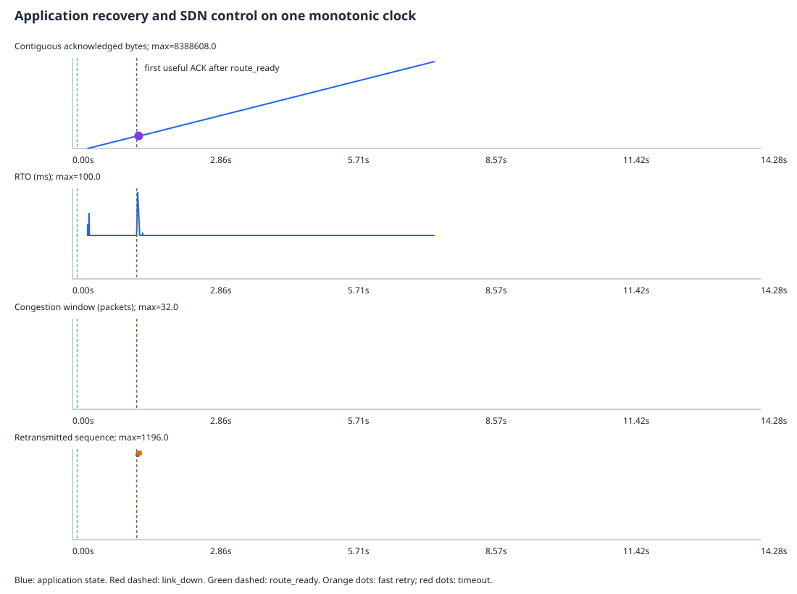

# Reliable UDP file transfer with SDN failover

Transfer a binary file over UDP while an SDN controller routes around a failed
or degraded network path. The C application repairs missing packets; the OS-Ken
controller restores reachability through a four-switch Mininet diamond.

## Try a file transfer on localhost

Use a C compiler and Make. Open two terminals in the repository:

1. Build: `make`
2. In terminal A: `./server 9000 received.bin`
3. Within ten seconds, in terminal B: `./client --host 127.0.0.1 --port 9000 --file README.md && cmp README.md received.bin`

A successful comparison prints nothing. Start a new receiver for each transfer.
For a visible retransmission demo, send a larger file and add `--drop-rate 0.05`
to the client command. Each outgoing DATA attempt has a 5% chance of simulated
loss. See `./client --help`. Run `make test` for automated checks (requires Python 3).

## Demonstrate SDN recovery

For a prepared Linux Docker host, demonstrate one transfer surviving link failure:

```sh
docker build -t rudp-lab .
docker run --rm --privileged -v "$PWD/results:/project/results" rudp-lab python scripts/run.py demo --mode failover --output "results/demo-$(date +%Y%m%d-%H%M%S)"
```

Expect `LINK DOWN`, alternate `ROUTE READY`, then `success=True` and
`sha256_match=True`. [Demo setup, native Linux and static contrast](docs/DEMO.md).

## Application and controls

Each receiver handles one upload. It verifies size and whole-file CRC before
atomically replacing the destination; failed transfers preserve existing output.
The experiment harness independently compares SHA-256 digests.

| Client switch | Values | Default |
| --- | --- | --- |
| `RUDP_RTO` | `fixed`, `adaptive` | `adaptive` |
| `RUDP_SACK` | `0` (individual ACK), `1` (bitmap) | `1` |
| `RUDP_CC` | `0` (fixed window), `1` (capped congestion window) | `1` |

Run `python3 scripts/run.py --help` for all lab commands, or
`python3 scripts/run.py benchmark --help` for localhost benchmark options.

The named client options override environment defaults. Use `--fixed-rto`,
`--no-sack` or `--no-cc` to select baselines. The codec explicitly serializes
fixed-width fields in network byte order and computes the CRC over wire bytes.
The 24-byte header never depends on native C structure padding.

Selective Repeat uses 32 slots; SACK, Karn-safe adaptive timers, bounded backoff,
fast gap retransmission and congestion control remain independently reproducible.
For example: `RUDP_RTO=fixed RUDP_SACK=0 RUDP_CC=0 ./src/client 127.0.0.1 9000 input.bin`.
Use a new receiver for each transfer. Old servers require `RUDP_SACK=0`.

## Evaluation and repository map

The full evaluation runs tests, a three-repeat routing/RTO/ACK matrix, reverse
recovery, soft degradation and loss/reordering/flaps. CC is off in that Linux
matrix; the separate local benchmark includes CC comparisons. It can take over
an hour. Use a fresh output directory; do not overwrite retained evidence.

```sh
docker run --rm --privileged -v "$PWD/results:/project/results" rudp-lab python scripts/run.py evaluate --output "results/evaluation-$(date +%Y%m%d-%H%M%S)"
```

| Location | Purpose |
| --- | --- |
| `src/` | C sender, receiver, packet serialization and socket helpers |
| `controller/` | Path policy, bidirectional probes and OpenFlow handlers |
| `mininet/` | Diamond topology and netem impairments |
| `scripts/` | Setup, demo, evaluation, local benchmark and plots |
| `tests/` | Protocol, transport, controller and integration tests |
| `results/` | Final Linux/local evidence and labelled historical archive |
| `docs/` | [Architecture](docs/ARCHITECTURE.md), [code map](docs/CODE_MAP.md), [design decisions](docs/DESIGN_DECISIONS.md), [validation](docs/VALIDATION.md), [report](docs/REPORT.md), [viva](docs/VIVA.md), [rubric](docs/RUBRIC_MAPPING.md) |

This is a topology-specific lab implementation, not a production transport.
It provides no authentication, encryption, persistent resume or TCP fairness.
[MIT license](LICENSE).

## Measured failover



The retained Linux trial shows the sequence of controller and application events.
Across the measured evaluation, 132 transfers matched their hashes and 48 static
failures were expected. [Measurements and scope](docs/KEY_RESULTS.md).
